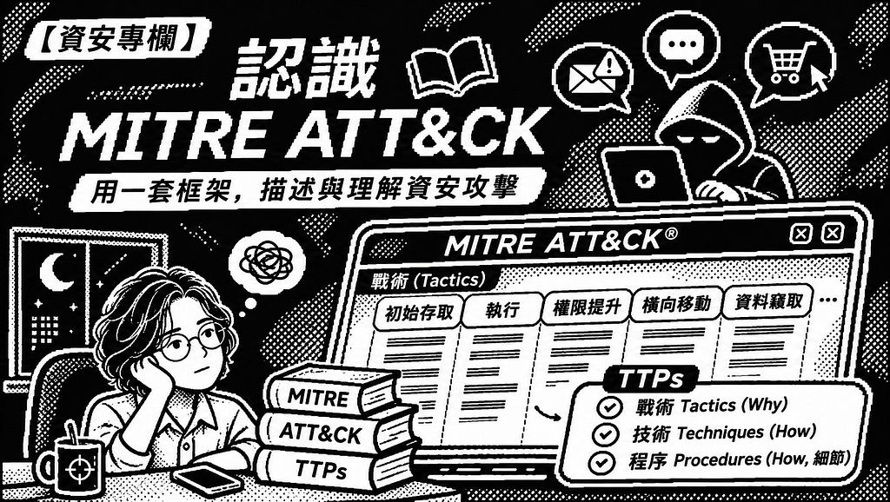
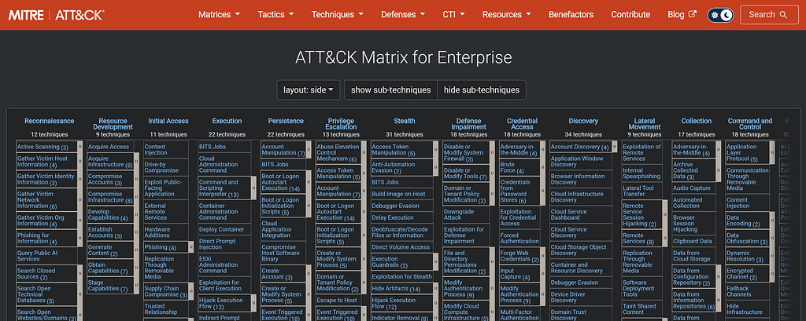

當講到資安攻擊時，你會想到什麼？一個黑帽Ｔ的人在電腦前敲敲打打在幾秒間破解系統的刻板印象曾在過去的電影中作為資安攻擊或是駭客的刻板印象；然而，實際上的資安攻擊者或許跟你我一樣在電腦前久坐、年過三十後開始感受到腰酸背痛、在晚上狂刷短影音失眠；資安攻擊亦是如此，一封普通的電子郵件、一封簡訊、一頁式購物網站都可能是攻擊的一部分。

為此，我想寫一系列科普專欄來介紹資安，並從更平易近人的角度切入。

當遇到資安攻擊時，我們要**怎麼描述**？有沒有一個類似於字典這一類工具書的統一框架可以用來描述資安攻擊？而MITRE ATT&CK正是資安公司、軟體從業者、企業常用於描述資安事件的框架。

先從 MITRE說起，MITRE是一個非營利組織，由聯邦政府資助的研究與開發機構。(轉自[官網](https://www.mitre.org/))

而[ATT&CK](https://attack.mitre.org/)為**A**derversarial **T**actics,**T**echniques, and **C**ommon **K**nowledge，對抗性戰術、技術與常見知識，則是一個架構、同時也是一個系統化的知識庫。

附圖為ATT&CK網頁內容，矩陣上方為戰術Tactics，下方直排則為各個戰術中的各種技術Techniques。

常用於描述攻擊的TTPs包含了前面兩者，最後一個則是Procedure，代表實際攻擊者執行攻擊時使用的手段，也就是技術細節。這邊補充一下，技術Techniques有些還有子技術sub-technique，把相似的攻擊方法更加細部地分類。

**戰術**本身代表了Why，為什麼攻擊要這樣做？其目的為何者？舉例來說[Privilege Escalation](https://attack.mitre.org/tactics/TA0004)權限提升這一個戰術的目的在於提升攻擊者在系統中的權限，後續以便於操控系統進行更多如破壞或竊取資料等行為。

**技術**則代表了How，攻擊者如何做到這種攻擊？以[Privilege Escalation](https://attack.mitre.org/tactics/TA0004)底下的[Access Token Manipulation](https://attack.mitre.org/techniques/T1134)存取權杖操縱為例，攻擊者透過操弄系統中的使用者身分得到更多的權限以利於進一步的攻擊）。

在更進一步地到[Access Token Manipulation](https://attack.mitre.org/techniques/T1134)下方的Procedure程序第一個[AppleSeed](https://attack.mitre.org/software/S0622)這起事件中的描述，可以看到"[AppleSeed](https://attack.mitre.org/software/S0622) can gain system level privilege by passing SeDebugPrivilege to the AdjustTokenPrivilege API.[\[2\]](https://blog.malwarebytes.com/threat-analysis/2021/06/kimsuky-apt-continues-to-target-south-korean-government-using-appleseed-backdoor/)"，說明[AppleSeed](https://attack.mitre.org/software/S0622)是透過把SeDebugPrivilege傳遞給AdjustTokenPrivilege以獲得系統權限。

以上是今天的專欄，介紹MITRE 與ATT&CK還有TTP，接下來會繼續撰文介紹Tactic與ATT&CK中的各個項目。感謝您的閱讀。
